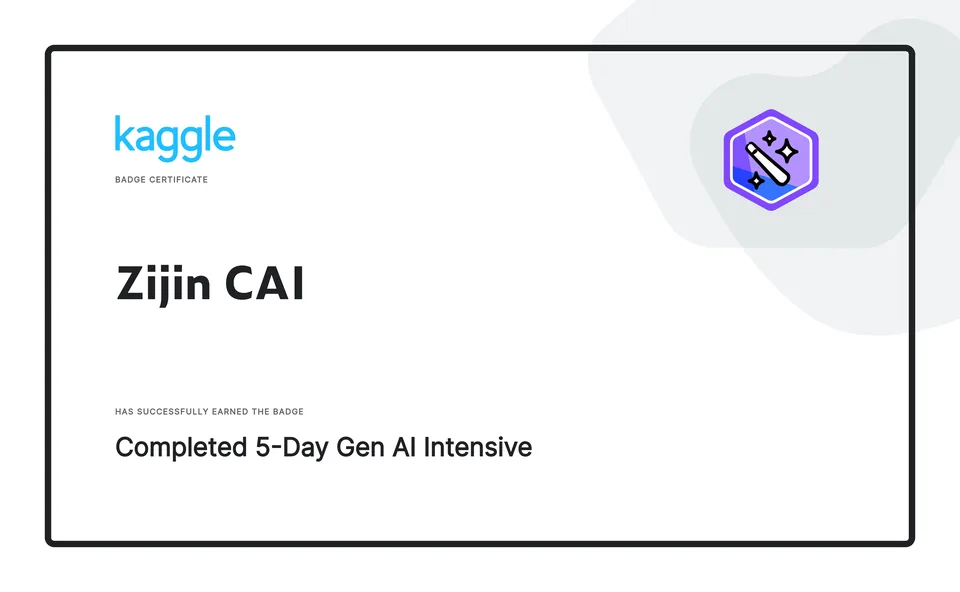
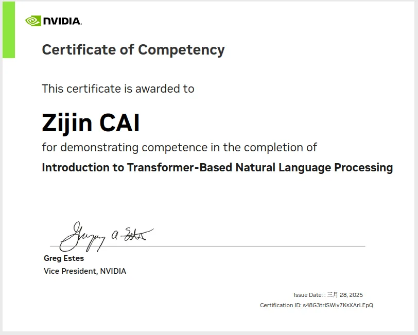
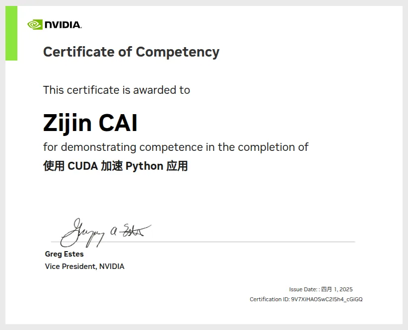
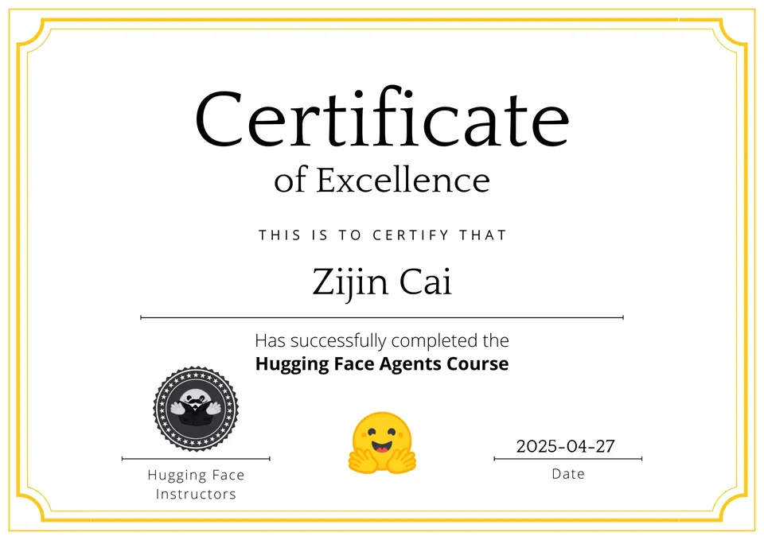

<h1 align="center">Zijin CAI</h1>

  <b>PhD student in AI</b> · The Chinese University of Hong Kong, Shenzhen

  Multimodal models · generative artefacts · language agents

  <a href="https://cai991108.github.io/">Website</a> ·
  <a href="mailto:zijincai@link.cuhk.edu.cn">Email</a> ·
  <a href="https://huggingface.co/jimchoi">Hugging Face</a> ·
  <a href="https://github.com/CAI991108">GitHub</a>

## Now

- **PhD in AI** at CUHK-Shenzhen — multimodal perception and generative models.
- **Research Fellow** at the [CUHK(SZ)–CROSS Joint Laboratory](https://github.com/CUHKSZ-CROSS-Lab) — AI for cross-border e-commerce.
- Research intern at the **Shenzhen Research Institute of Big Data** (2025) — OCR text detection and recognition.
- Before AI: three years as a **quant researcher** — Python systems, back-testing, live trading.

中文简介

CUHK(SZ) 人工智能博士生，研究方向是多模态感知与生成模型。同时在 CUHK(SZ)–CROSS 联合实验室做跨境电商方向的 AI 研究与工程。

在深圳市大数据研究院实习时用 MindOCR 做文本检测与识别；在那之前做了三年量化研究，写 Python 系统、做回测、跑实盘。

现在主要在做多模态模型与语言 agent 的工程实现。

## Lab

**Research Fellow** at the [CUHK(Shenzhen) – CROSS Joint Laboratory](https://github.com/CUHKSZ-CROSS-Lab),
a joint lab of the School of Artificial Intelligence and Shenzhen Kuafu-Yundun Technology, working on AI
for cross-border e-commerce — data governance, demand forecasting, risk control, and LLM applications in
operational decision-making.

I work on the engineering side of that agenda: the systems that carry the models into daily operations
(`crossledger`, `crossbooks`), mostly TypeScript, Vue and Python. Most of that code is private.

## Focus

  
  
  
  
  

## Selected work

| Project | What it does | Stack |
| :-- | :-- | :-- |
| **[JD_search_agent](https://github.com/CAI991108/JD_search_agent)** | Stateful shopping assistant: text + image-OCR retrieval, orchestrated as a LangGraph state machine | LangGraph · Qwen-VL · Playwright |
| **[Robotic-Action-Frame-Prediction](https://github.com/CAI991108/Robotic-Action-Frame-Prediction-with-InstructPix2Pix)** | Fine-tuned InstructPix2Pix that predicts a robot's next frames at 256×256 | PyTorch · Diffusers |
| **[SD3M-SimpleTuner-lora](https://github.com/CAI991108/SD3M-SimpleTuner-lora)** | LoRA fine-tune of Stable Diffusion 3 Medium; weights published on Hugging Face | Diffusers · LoRA |
| **[Machine-Learning-and-Language-Model](https://github.com/CAI991108/Machine-Learning-and-Language-Model)** | GPT-2 / Llama pre-training and fine-tuning, LoRA + BAdam memory tricks, GSM8K evaluation | PyTorch · Transformers |

Coursework in NLP, deep learning, ML, computer vision and optimisation lives in the `*-Utils` repositories. The CUHK-SZ LaTeX template I maintain is [here](https://github.com/CAI991108/CUHKSZ-SAI-LaTeX_Template).

## Toolbox

  
  
  
  

  
  
  
  

  
  
  
  

## Coding activity

  
  
   
  
   
  
   
  

  
  

## Awards

Certificates

  
   
  
  
   
  

## Contact

Open to research collaborations and internships. The fastest way to reach me is
[zijincai@link.cuhk.edu.cn](mailto:zijincai@link.cuhk.edu.cn); I am based in Shenzhen.
